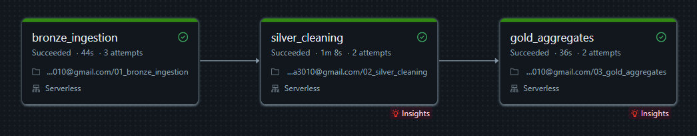
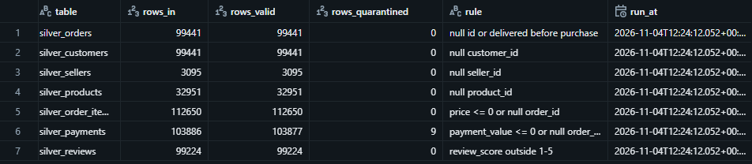
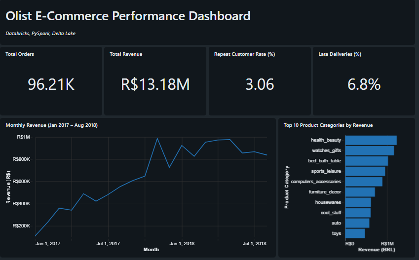
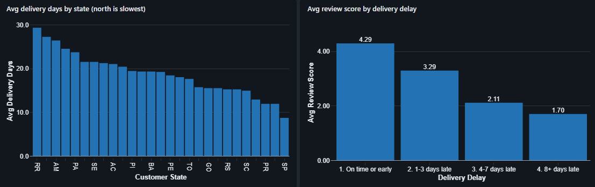

# Olist Medallion Pipeline on Databricks

A personal project: an end-to-end data pipeline on Databricks that takes the raw Olist Brazilian e-commerce CSVs through Bronze, Silver and Gold layers, validates the data, and serves the results in a SQL dashboard.

**Stack:** Databricks (Free Edition, serverless), PySpark, Delta Lake, Unity Catalog, Databricks Workflows, Databricks SQL dashboards

**Dataset:** [Brazilian E-Commerce Public Dataset by Olist](https://www.kaggle.com/datasets/olistbr/brazilian-ecommerce) (Kaggle). About 99K orders from Sep 2016 to Oct 2018 across 9 related tables. The raw files are not included in this repo.

---

## What I wanted to find out

1. How does delivery performance vary across Brazilian states?
2. Do late deliveries go along with lower review scores?
3. How many customers come back for a second order?
4. Which categories and sellers drive revenue?

---

## Architecture

```
Raw CSVs (Unity Catalog Volume)
        |
        v
  BRONZE  - raw tables, all columns as strings, plus ingestion metadata
        |
        v
  SILVER  - typed, deduplicated, validated; failing rows go to quarantine tables
        |
        v
  GOLD    - business-level aggregates
        |
        v
  SQL dashboard
```

All three notebooks run as one Databricks Workflow (`olist_medallion_pipeline`): `bronze_ingestion` -> `silver_cleaning` -> `gold_aggregates`.



| Layer | Notebook | What it does |
|---|---|---|
| Bronze | `01_bronze_ingestion` | Reads the 9 CSVs and writes them as Delta tables, unchanged. Adds `_ingested_at` and `_source_file`. |
| Silver | `02_silver_cleaning` | Casts types, removes duplicates, standardizes text, translates product categories, applies data quality rules, builds `silver_orders_enriched` with delivery and delay metrics. |
| Gold | `03_gold_aggregates` | Builds the tables the dashboard reads (see below). |

### Gold tables

| Table | Contents |
|---|---|
| `gold_monthly_revenue` | Orders, revenue, freight and average order value per month |
| `gold_category_performance` | Revenue, orders and average price per product category |
| `gold_delivery_by_state` | Average delivery days, delay, % late and review score per customer state |
| `gold_seller_performance` | Orders, revenue, review score and % late per seller |
| `gold_repeat_customers` | Customer count and repeat-order rate |
| `gold_delay_vs_review` | Average review score by how late the order was |

---

## Design decisions

- **Bronze stays raw.** Every column is read as a string, so no ingestion fails on bad data. Typing happens in Silver.
- **Safe casting.** Silver uses `try_cast` and `try_to_timestamp`, so a malformed value becomes null instead of crashing the job.
- **Quarantine instead of delete.** Rows that fail a rule are written to a `quarantine_*` table with a reason, so nothing is silently lost.
- **Data quality log.** Each run appends row counts (in, valid, quarantined) per table to `dq_log`, which keeps a history across runs.
- **Reviews are deduplicated per (review_id, order_id).** Some review IDs repeat across orders, so the latest answer is kept.
- **Repeat customers use `customer_unique_id`.** `customer_id` changes with every order, so using it would hide repeat buyers.
- **Delivered orders only** for revenue and delivery KPIs.
- **Partial months excluded** from the revenue trend (Sep to Dec 2016 and Sep to Oct 2018).

### Data quality results



Seven Silver tables were validated. Only the payments rule caught anything: **9 of 103,886 payment rows (0.009%)** had a value of zero or less and went to quarantine. All other tables passed with no violations, and the row counts match the source files. The dataset is already quite clean, so there was little to fix beyond typing and category translation.

---

## Dashboard





---

## Findings

**1. Late deliveries go along with much lower review scores.**

(Chart: The "Avg review score by delivery delay" chart is in the second dashboard screenshot above.)

| Delivery | Orders | Avg review score |
|---|---|---|
| On time or early | 89,443 | 4.29 |
| 1-3 days late | 1,852 | 3.29 |
| 4-7 days late | 1,748 | 2.11 |
| 8+ days late | 2,781 | 1.70 |

Only about 7% of delivered orders arrive late, but they score far lower. Even a delay of 1 to 3 days costs about a full point. This is an association: late orders may also involve other problems (damaged or wrong items), so the data does not prove lateness is the cause.

**2. Delivery time varies a lot by region.** Northern states such as RR and AM take roughly 25 to 29 days on average, while SP takes about 9.

**3. Customer retention is very low.** Of 95,560 unique customers, only 2,924 (**3.06%**) ordered more than once. This marketplace looks acquisition-heavy. A possible follow-up is whether poor delivery experiences contribute to this, which these tables cannot answer on their own.

**4. Revenue grew through 2017 and then levelled off.** Monthly revenue climbed to around R$1M by late 2017 and stayed roughly between R$800K and R$1M through mid-2018. The top categories by revenue are `health_beauty`, `watches_gifts` and `bed_bath_table`.

---

## Repo structure

```
olist-databricks-pipeline/
├── README.md
├── notebooks/
│   ├── 01_bronze_ingestion.py
│   ├── 02_silver_cleaning.py
│   └── 03_gold_aggregates.py
└── images/
```

## How to run it

1. Create a Databricks workspace (Free Edition works) and download the Olist dataset from Kaggle.
2. Create the schema and volume, then upload the 9 CSVs to the volume:
   ```sql
   CREATE SCHEMA IF NOT EXISTS workspace.olist;
   CREATE VOLUME IF NOT EXISTS workspace.olist.raw;
   ```
3. Import the three notebooks from `notebooks/`. If your catalog is not named `workspace`, change `CATALOG` at the top of each notebook.
4. Create a Job with three notebook tasks on serverless compute, chained in order (bronze, then silver, then gold), and run it.
5. Build a dashboard on the `gold_*` tables.

---

## Limitations and what I would do next

- **Full reload, not incremental.** Each run overwrites the tables. Auto Loader and `MERGE` would be the next step for incremental loads.
- **Zero-value payments are quarantined by a rule I chose.** Some may be legitimate (for example vouchers), so the rule could be refined.
- **Small differences between KPI definitions.** The dashboard's late-delivery rate (6.8%) is calculated slightly differently from the 6.7% I get from delivered orders with a delivery date. I kept the dashboard value as is.
- **Geolocation table is not used.** It is large and heavily duplicated, and none of the current questions need it. It would be needed for a map view.
- **No automated tests or alerts.** Adding failure notifications and unit tests for the transformations would make it more production-like.
- **No delivery-delay prediction model yet.** An MLflow-tracked model would be a natural extension.

---

## Author

Mehak Arora | [LinkedIn](https://www.linkedin.com/in/mehakar/) | [GitHub](https://github.com/Mehak3010/)
